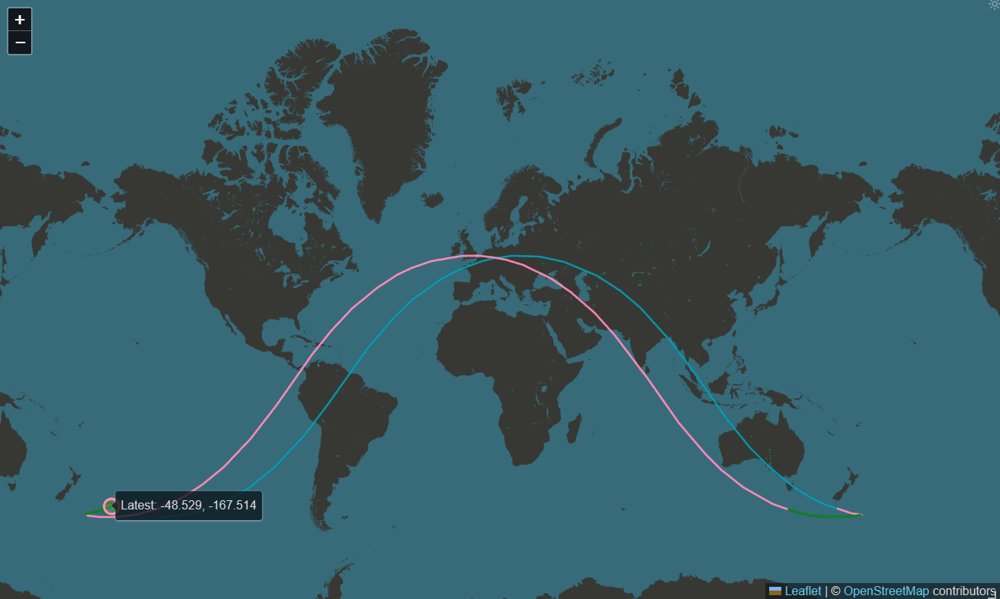

# ISS Orbital Tracker

A streaming data pipeline on Azure that follows the International Space Station. A small VM polls a public API every 10 seconds and sends each position to Azure Event Hubs. Azure Databricks reads the events with Structured Streaming into Bronze, Silver and Gold Delta tables and draws the orbit on an interactive map.



## What it does

- Collects the live ISS position (latitude, longitude, timestamp) from the [Open Notify API](http://open-notify.org/Open-Notify-API/ISS-Location-Now/).
- Buffers every reading in Azure Event Hubs, enabling the replayable log the API lacks.
- Processes the events incrementally with Spark Structured Streaming on Databricks serverless compute.
- Stores raw, cleaned and analysis-ready data in a Bronze / Silver / Gold (medallion) layout.
- Draws the orbital tracks, one colour per orbit, on a world map. With two or more orbits you can see each pass shift about 23 degrees west, because the Earth rotates beneath the station.

## Architecture

```
ISS API  -->  Producer VM  -->  Event Hubs  -->  Bronze  -->  Silver  -->  Gold  -->  Map
(HTTP)       (Python,          (hub, 2          (raw        (typed,      (deduped,   (Folium,
             systemd,          partitions,      events)     validated)   orbit       CSV)
             managed id)       7-day log)                                numbers)
```

| Stage | What happens | Type |
|---|---|---|
| Producer VM | Polls the API every 10 seconds and sends the raw JSON as one event | Continuous, bounded by a duration you set |
| Event Hubs | Stores events with a partition and offset, retained for 7 days | Managed log |
| Bronze | Copies each event as received, plus partition, offset and timestamps | Finite stream (`availableNow`) |
| Silver | Parses the JSON, validates coordinates, adds typed columns | Finite stream (`availableNow`) |
| Gold | Removes duplicate readings, numbers the orbits, adds derived columns | Batch |
| Map | Folium map and charts, rendered inline | Interactive notebook |

## Tech stack

| Component | Technology |
|---|---|
| Cloud | Microsoft Azure |
| Message broker | Azure Event Hubs, Standard tier, Kafka-compatible endpoint |
| Producer | Python on an Ubuntu VM, `azure-eventhub`, `azure-identity`, `requests` |
| Processing | Azure Databricks (Premium, Unity Catalog), serverless compute |
| Streaming | Spark Structured Streaming, Kafka source, `trigger(availableNow=True)` |
| Storage | Delta Lake managed tables, Unity Catalog Volume for checkpoints |
| Authentication | Managed identities and a Unity Catalog service credential, no keys |
| Visualisation | Databricks `display()` and Folium |

## Repository structure

```
iss-realtime-tracker/
├── README.md
├── notebooks/
│   ├── 00_Setup.ipynb              # configuration, schema, Volume
│   ├── 01_Connection_Test.ipynb    # batch read of the hub to prove access
│   ├── 02_Bronze_Stream.ipynb      # Event Hubs -> Bronze
│   ├── 03_Silver_Stream.ipynb      # Bronze -> Silver
│   └── 04_Gold_and_Map.ipynb       # Gold, charts, Folium map, CSV export
├── producer/
│   └── producer.py              # the script that runs on the VM
├── docs/
│   └── folium_map.png
└── data/
    └── iss_positions.csv        # sample export of the Gold table
```

## Data model

All tables live in the `iss_tracker` schema of the workspace catalog.

**Bronze: `bronze_events`** (raw, unparsed)

| Column | Type | Description |
|---|---|---|
| `raw_json` | string | The API response exactly as sent |
| `partition` | int | Event Hubs partition the event came from |
| `offset` | bigint | Position of the event in its partition |
| `broker_time` | timestamp | When Event Hubs received the event |
| `processed_at` | timestamp | When Spark wrote the row |

The pair (`partition`, `offset`) identifies each event uniquely.

**Silver: `silver_positions`** (typed and validated)

| Column | Type | Description |
|---|---|---|
| `lat` | double | Latitude in degrees, between -90 and 90 |
| `lon` | double | Longitude in degrees, between -180 and 180 |
| `event_ts` | bigint | Unix timestamp recorded by the API |
| `event_dt` | timestamp | `event_ts` as a UTC timestamp |
| `date_part` | string | Date, `YYYY-MM-DD` |
| `broker_time`, `partition`, `offset` | | Carried over from Bronze for lineage |

**Gold: `gold_positions`** (analysis-ready, rebuilt on every run)

| Column | Type | Description |
|---|---|---|
| Silver columns | | Deduplicated by `event_ts` |
| `orbit_number` | int | Orbit counted from the first reading, using a 5,574 second period |
| `hemisphere` | string | Northern or Southern |
| `altitude_km` | double | Constant 408, the mean ISS altitude (not measured) |
| `speed_kmh` | double | Constant 27,600, the mean ISS speed (not measured) |
| `processed_at` | timestamp | When Gold was built |

## Prerequisites

- An active Azure subscription with credit (built on Azure for Students).
- Permission to create resources and assign roles (Owner, or Contributor plus role-assignment rights).
- Quota for a small VM such as `Standard_B1s` in your region.
- A Premium Azure Databricks workspace with Unity Catalog and serverless notebooks.
- Event Hubs must be the **Standard** tier, because the Basic tier has no Kafka endpoint.

## Setup

### 1. Azure resources

1. Create a resource group.
2. Create an Azure Databricks workspace (Premium, default managed network).
3. Create an Event Hubs namespace (Standard, 1 throughput unit, auto-inflate off, public network access enabled) and a hub with 2 partitions, 7-day retention and Capture off.
4. Create an Ubuntu 24.04 VM with a system-assigned managed identity, a Standard static public IP (outbound only) and **no inbound ports**.
5. Create an Access Connector for Azure Databricks and copy its resource ID.
6. On the hub, assign **Azure Event Hubs Data Sender** to the VM and **Azure Event Hubs Data Receiver** to the access connector.

### 2. Databricks

1. Create a Unity Catalog service credential from the access connector's resource ID.
2. Run `00_Setup` once: it defines the configuration, creates the `iss_tracker` schema and the `pipeline_state` Volume.

### 3. Producer

1. On the VM (through Run command, no SSH needed), install Python, a virtual environment and the Azure libraries, and place `producer/producer.py` and a `config.json` with your namespace and hub name in `/opt/iss-producer`.
2. Register it as a systemd service that runs `producer.py --minutes <N>`.
3. Run a dry run (sends nothing), then a short test send, then start the real collection.

The producer signs in with the VM's managed identity. No key, password or connection string is stored anywhere.

## Running the pipeline

| Step | What | Where |
|---|---|---|
| 1 | Run `01_Connection_Test` to confirm Databricks can read the hub | Databricks |
| 2 | Start the producer with the duration you want | VM |
| 3 | Run `02_Bronze_Stream`, then `03_Silver_Stream` (any time, repeatable) | Databricks |
| 4 | Run `04_Gold_and_Map` to rebuild Gold and draw the map | Databricks |

Each stream run copies only the events it has not seen yet, then stops. You can run steps 3 and 4 while the producer is still sending, and again after it stops.

**How long to collect.** One orbit takes about 93 minutes.

| Collection time | What the map shows |
|---|---|
| 10 minutes | A short arc, about 7% of an orbit |
| 95 minutes | One full orbit, a single sine curve |
| 190 minutes | Two orbits, the second shifted about 23 degrees west |
| 380 minutes | Four orbits, the overlapping sine-wave look |

## Example run

One 190-minute collection run (two orbits) gave these producer figures:

| Measure | Value |
|---|---|
| Polling attempts (one every 10 seconds) | 1,140 |
| Events sent to Event Hubs | 921 (81%) |
| Failed API calls | 219 (19%) |
| Cause of every failure | Connection timeouts from the free ISS API |

The producer logged each failed call and carried on, so it never stalled. A single miss leaves a gap of about 20 seconds, and the map only breaks a line where more than 60 seconds pass without a reading, so the orbit tracks stay clearly visible. Expect the coverage per full orbit to be about 80%, which reflects the API's reliability, not the pipeline.

The coverage query on the Gold table gave:

| Orbit | Readings | Captured | Start (UTC) | End (UTC) |
|---|---|---|---|---|
| 1 | 426 | 76.4% | 2026-11-15 17:50:40 | 2026-11-15 19:23:32 |
| 2 | 460 | 82.5% | 2026-11-15 19:23:43 | 2026-11-15 20:56:26 |
| 3 | 38 | 6.8% | 2026-11-15 20:56:44 | 2026-11-15 21:04:32 |

How to read it:

- **Orbit length.** Orbits 1 and 2 each span about 92.9 minutes, which matches the 5,574 second period used for orbit numbering.
- **Nothing lost after Event Hubs.** The three orbits add up to 924 readings in Gold. That is the 921 events the producer sent, plus a few from an earlier test send, so no rows were dropped or duplicated between the VM and Gold.
- **Orbit 3 is partial** because the producer stopped after 190 minutes, so only the first minutes of a third orbit exist.
- **Orbit 1 is lower than orbit 2.** The first reading comes from the test send before the real run started, which leaves a gap at the start of orbit 1.
- **The map shows the westward shift.** The second orbit's track sits west of the first, because the Earth rotates beneath the station between passes.

## Design decisions

- **Why Event Hubs.** The ISS API only returns the current position and has no history, so it cannot be a replayable Spark source. Event Hubs stores each reading with a partition and offset, which gives checkpoints something to resume from.
- **Finite streams on serverless.** Serverless notebooks and jobs do not support time-based triggers (`processingTime` at any interval, or `continuous`), and a streaming query with no trigger fails, because Spark defaults to `processingTime`. Databricks recommends `trigger(availableNow=True)` on serverless, so Bronze and Silver use it: each run processes whatever is new, then stops. An always-on stream on serverless would need Lakeflow pipelines in continuous mode instead.
- **Raw Bronze.** Bronze keeps the payload unparsed. Event Hubs deletes events after 7 days, so Bronze is the long-term replay point: if Silver logic changes, reprocess from Bronze with a new checkpoint.
- **Deduplication in Gold.** A stream can only deduplicate with state. Gold removes duplicate `event_ts` values in batch, which is cheaper and simpler here.
- **Two partitions.** The volume is one event every 10 seconds, so partitions give no speed benefit. They are used to work with partitions and per-partition offsets. Events are ordered only within a partition, so Silver and Gold do not rely on Bronze order.
- **Map rendering.** The map is drawn with `displayHTML(m._repr_html_())`, so no files need to be written. Lines are split at the antimeridian, at gaps in collection and at orbit boundaries, so nothing streaks across the globe.

## Security

- Managed identities replace keys: the VM sends as its own identity, and Databricks reads as the access connector through a Unity Catalog service credential.
- Sender and Receiver are separate roles on separate identities, scoped to the one hub.
- The VM has no inbound ports. Its public IP only provides outbound access, and commands run through the Azure VM agent.
- The Event Hubs namespace allows public network access, so access is controlled by identity and role, not by network.

## Cleanup

When you have saved the map, the CSV and the notebooks:

1. Stop the producer.
2. Export everything you need.
3. Delete the resource group.

## Limitations

- **Not a continuously running stream.** The producer is continuous, but the Databricks side runs in finite bursts you trigger. It is incremental micro-batch processing with Structured Streaming.
- **The producer is the single point of loss.** If the VM is down or the API is unreachable, those readings are lost, because the API has no history. The free API drops requests regularly: in the example run, 219 of 1,140 polls (19%) timed out and were skipped. A simple improvement would be to retry a failed call once or twice within the same 10-second slot, which would recover most of the lost readings.
- **Gold is a snapshot.** It reflects Silver at the moment you last ran it.
- **The orbital period is an approximation**, so orbit boundaries are approximate and the last orbit is usually partial.

## Data source

Position data comes from the Open Notify API.
